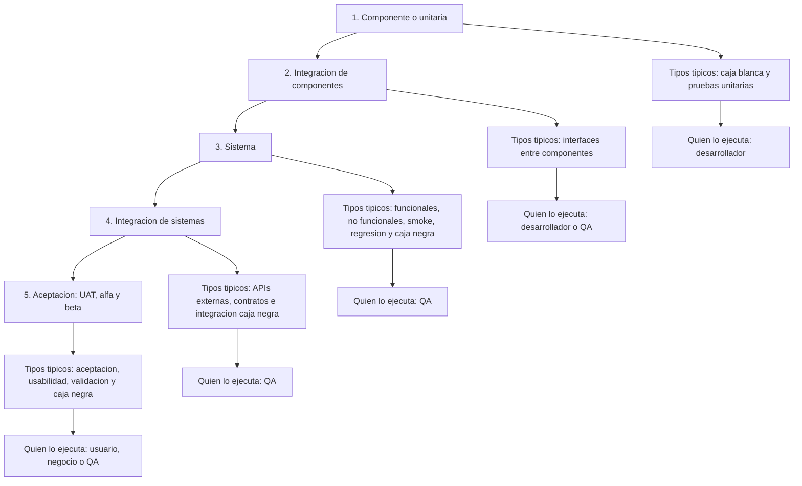

# Mapa de niveles y tipos de prueba

Este mapa relaciona los cinco niveles de prueba de ISTQB CTFL v4.0 con los tipos de prueba más habituales en cada uno y con quién suele ejecutarlos. Un tipo no pertenece a un solo nivel: por ejemplo, las pruebas funcionales y las de regresión pueden aparecer en varios, aunque cambian el alcance y quién las corre.

## Diagrama

Versión renderizada del diagrama: [mapa-niveles-y-tipos.svg](mapa-niveles-y-tipos.svg).

En el diagrama las etiquetas van sin tildes para que Mermaid renderice de forma estable. La tabla siguiente usa la ortografía correcta.

## Tabla equivalente

| Nivel | Qué se prueba | Tipos de prueba típicos | Quién lo ejecuta normalmente |
| --- | --- | --- | --- |
| 1. Componente (unitaria) | Una unidad aislada: método, clase o función | Caja blanca, pruebas funcionales unitarias, a veces rendimiento a nivel de unidad | Desarrollador |
| 2. Integración de componentes | La interacción entre partes de un mismo sistema | Interfaces internas, caja blanca o caja negra, pruebas funcionales de integración | Desarrollador o QA |
| 3. Sistema | El sistema completo, de punta a punta, contra los requisitos | Funcionales, no funcionales (rendimiento, usabilidad, seguridad, compatibilidad), smoke, sanity, regresión, retest, caja negra | QA |
| 4. Integración de sistemas | La interacción con otros sistemas: APIs externas, pasarelas de pago, core bancario | Funcionales de integración, contratos de API, no funcionales de intercambio, caja negra | QA |
| 5. Aceptación (UAT, alfa y beta) | Que el sistema sirve al negocio y al usuario | Aceptación, usabilidad, validación, operacionales o contractuales, caja negra. Alfa: entorno controlado del equipo. Beta: entorno del usuario | Usuario, negocio o QA en apoyo |

## Explicación breve

Los niveles responden a *qué tan grande es lo que se está probando* y se suelen recorrer de abajo hacia arriba: primero la unidad, luego cómo se habla con las demás unidades, después el sistema completo, más adelante sus vecinos externos y, al final, si eso le sirve al usuario.

Los tipos responden a *qué aspecto se evalúa* o *con qué técnica*. Por eso un mismo tipo puede repetirse en varios niveles. La caja blanca es natural en componente; la caja negra predomina desde sistema hasta aceptación. El smoke y la regresión se ven sobre todo en sistema, cuando ya hay un build completo. La UAT no busca encontrar todos los defectos: busca validar que el producto es el correcto.

En SauceDemo, la práctica de este módulo se sitúa sobre todo en **sistema** y **aceptación**, porque se prueba la tienda completa desde el navegador, sin acceder al código. Una prueba de integración de sistemas quedaría para un producto que sí se conecte, por ejemplo, a una pasarela de pago real.
